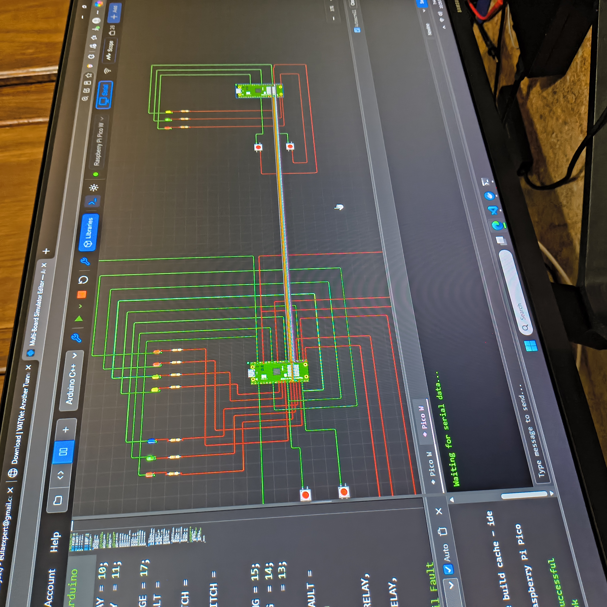
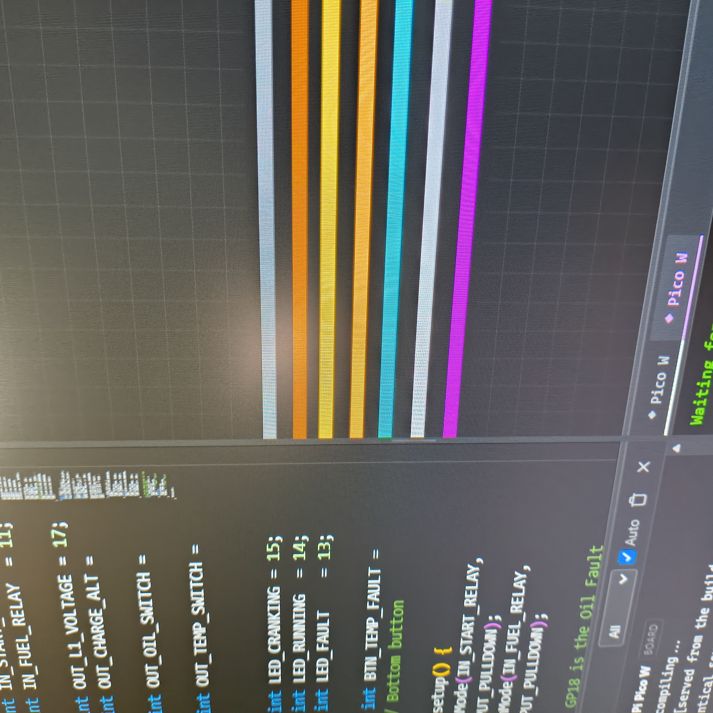
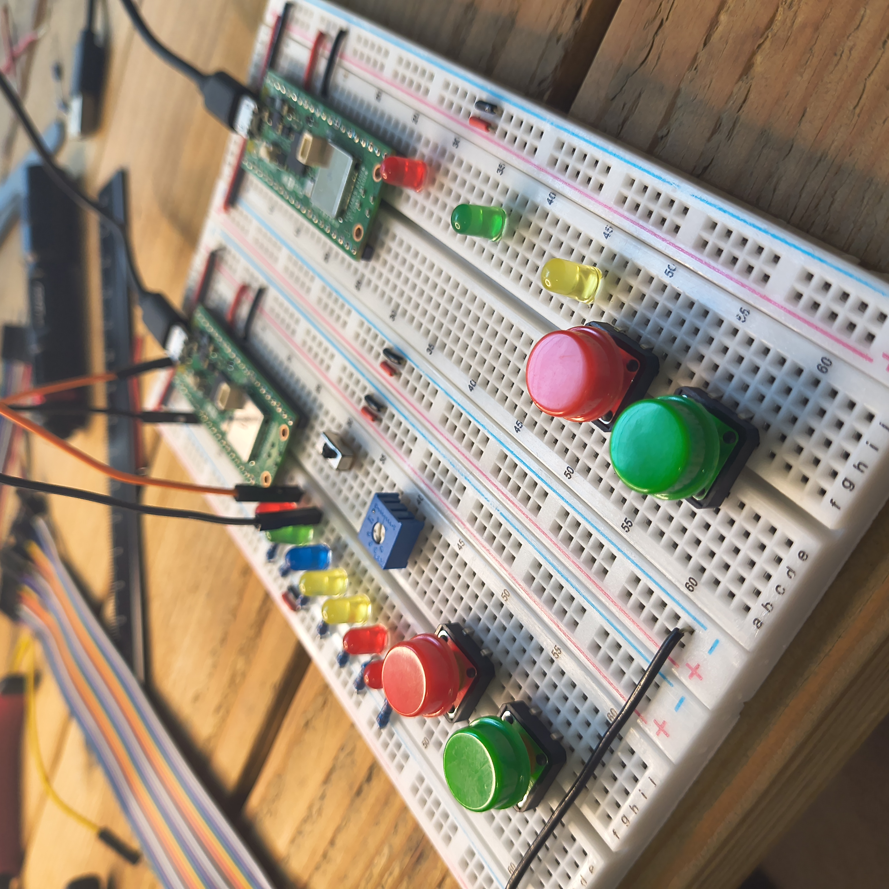
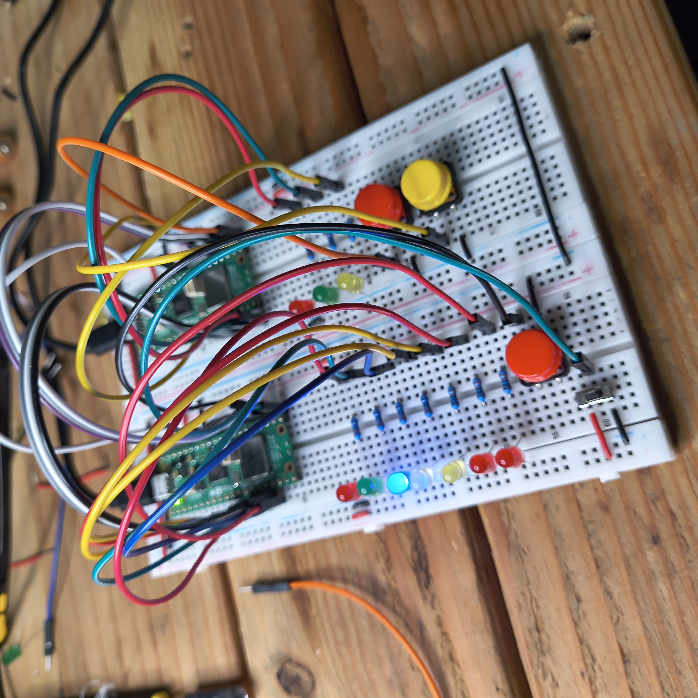
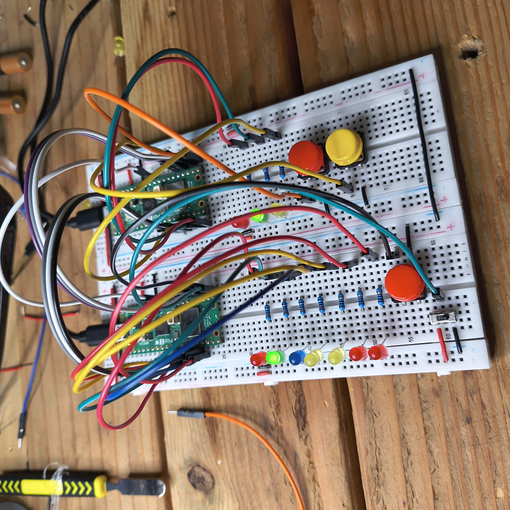
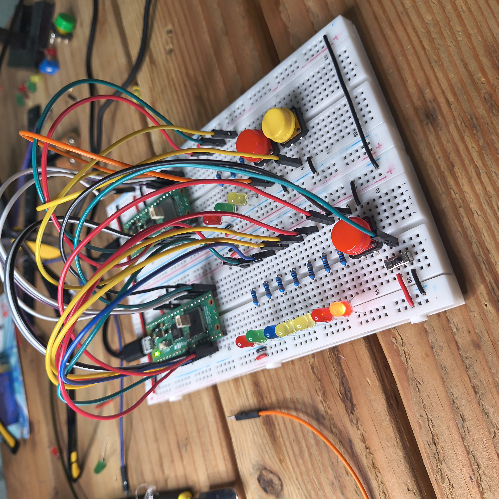

# MDA-A60Y1 Hardware-in-the-Loop (HIL) Emulator

A fully functional, dual-microcontroller test bench designed to emulate an industrial generator controller (CRE Technology MDA-A60Y1) and its engine. 

This project demonstrates strict embedded systems engineering, moving from digital simulation to physical breadboard validation.

## Architecture

The system uses two independent Raspberry Pi Pico 2 Ws communicating over a physical bridge:
- MDA Controller (Left): A non-blocking state machine implementing datasheet-accurate timings (Preheat, Crank, Cooldown) and fault latching.
- Engine Simulator (Right): Reads controller relay outputs and generates simulated analog/digital sensor feedback (L1 Voltage, Charge Alt, Oil, Temp).

## Tech Stack and Standards

- Language: C (C11)
- SDK: Raspberry Pi Pico SDK
- Standards: MISRA-C:2012, BARR-C, NASA JPL Power of 10
- Hardware: 2x Pico 2 W, 2 Breadboards, 10 LEDs, 3 Tactile Buttons, Slide Switch,

## Validation and Testing

The system was validated using a 7-step HIL test sequence:
1. Cold Start: Preheat -> Crank -> Run sequence.
2. Protection Hold-off: 12-second sensor ignore during engine stabilization.
3. Fault Injection: Oil, Temp, and Charge faults successfully shut down the engine and latch the controller.
4. Manual Reset: Fault states are cleared by dropping the remote start signal (Slide Switch).

## Gallery

### Digital Twin (Velxio Simulation)

### Physical Hardware Layout

### System States and Validation
Startup State (Preheat):

Engine Running (Healthy State):

Fault State Triggered (Latched Shutdown):

### UART Logging
Real-time state machine transitions captured via USB serial logging:

## How to Build

1. Clone the repo: git clone https://github.com/GoodFractals/MDA_Emulator.git
2. Open in VS Code with the Raspberry Pi Pico extension.
3. Run CMake: Build.
4. Flash MDA_Emulator.uf2 to the left Pico and Engine_Simulator.uf2 to the right Pico.
